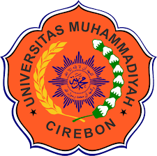

# PROPOSAL PERANCANGAN SISTEM INFORMASI AKADEMIK PRIBADI DAN MANAJEMEN TUGAS KULIAH BERBASIS WEB
# "YULI'S VAULT (YULI'S SECOND BRAIN)"
### *Personal Academic Vault & Task Management Web Application Berbasis Next.js 15, Prisma ORM, dan SQLite*

---

<div align="center">

**Diajukan Untuk Memenuhi Tugas Mata Kuliah:**  
### **ANALISIS DESIGN PL**

<br/>

**Dosen Pengampu:**  
### **Dian Novianti M.Kom**

<br/>



<br/>

**Disusun Oleh:**  
### **YULI INDIYANTI**
**NIM: 240511130 (Kelas TI24D)**

<br/>

### **PROGRAM STUDI S1 TEKNIK INFORMATIKA**
### **FAKULTAS TEKNIK**
### **UNIVERSITAS MUHAMMADIYAH CIREBON**
### **2026**

</div>

---

<div style="page-break-after: always;"></div>

## KATA PENGANTAR

Puji syukur senantiasa kami panjatkan ke hadirat Allah Subhanahu Wa Ta'ala atas limpahan rahmat, taufik, serta hidayah-Nya, sehingga penulis dapat menyelesaikan penyusunan dokumen proposal perancangan perangkat lunak yang berjudul **"PROPOSAL PERANCANGAN SISTEM INFORMASI AKADEMIK PRIBADI DAN MANAJEMEN TUGAS KULIAH BERBASIS WEB: YULI'S VAULT (YULI'S SECOND BRAIN)"** dengan baik dan tepat pada waktu yang telah ditetapkan.

Penyusunan dokumen proposal ini diajukan secara khusus guna memenuhi salah satu syarat evaluasi tugas besar pada mata kuliah **Analisis Design PL** di Program Studi S1 Teknik Informatika, Fakultas Teknik, **Universitas Muhammadiyah Cirebon (UMC)** pada Tahun Akademik 2026.

Penulis menyadari sepenuhnya bahwa penyusunan dokumen ini tidak lepas dari bimbingan, arahan, serta dukungan moral dari berbagai pihak. Oleh karena itu, melalui kesempatan yang berbahagia ini, penulis menyampaikan rasa hormat dan terima kasih yang setinggi-tingginya kepada:
1. **Ibu Dian Novianti M.Kom**, selaku Dosen Pengampu mata kuliah Analisis Design PL, yang telah memberikan ilmu, arahan, standar metodologi akademik, serta bimbingan berharga selama perkuliahan berlangsung.
2. Pimpinan Program Studi S1 Teknik Informatika dan segenap Civitas Akademika Fakultas Teknik Universitas Muhammadiyah Cirebon yang senantiasa memfasilitasi iklim riset serta pembelajaran inovatif.
3. Rekan-rekan mahasiswa Program Studi Teknik Informatika kelas TI24D angkatan 2024/2026 yang senantiasa bertukar pikiran, memberikan masukan konstruktif, serta memberikan dorongan solidaritas belajar.
4. Keluarga dan orang tua tercinta yang senantiasa memanjatkan doa, memberikan dukungan moril, serta dorongan materiil tanpa henti kepada penulis.

Penulis menyadari bahwa dokumen proposal ini masih memiliki keterbatasan dan ruang untuk penyempurnaan lebih lanjut. Oleh sebab itu, kritik dan saran yang konstruktif dari pembaca budiman sangat diharapkan guna penyempurnaan rancangan sistem ini di masa mendatang. Semoga proposal ini dapat memberikan kontribusi nyata bagi pengembangan rekayasa perangkat lunak akademik.

<br/>

Cirebon, 6 November 2026  
<br/>
**Penulis,**  
<br/>
**Yuli Indiyanti**  
NIM: 240511130  

---

<div style="page-break-after: always;"></div>

## DAFTAR ISI

- [KATA PENGANTAR](#kata-pengantar) ........................................................................................................................ ii
- [DAFTAR ISI](#daftar-isi) ...................................................................................................................................... iii
- [DAFTAR TABEL & DAFTAR GAMBAR](#daftar-tabel--daftar-gambar) ................................................................... vi
- [RINGKASAN EKSEKUTIF](#ringkasan-eksekutif) .................................................................................................... vii
- [BAB I: PENDAHULUAN](#bab-i-pendahuluan) ........................................................................................................ 1
  - [1.1 Latar Belakang Masalah](#11-latar-belakang-masalah) ................................................................................. 1
  - [1.2 Rumusan Masalah](#12-rumusan-masalah) ................................................................................................... 3
  - [1.3 Batasan Masalah & Ruang Lingkup Sistem](#13-batasan-masalah--ruang-lingkup-sistem) ............................ 4
  - [1.4 Tujuan Perancangan](#14-tujuan-perancangan) ........................................................................................... 5
  - [1.5 Manfaat Perancangan](#15-manfaat-perancangan) ....................................................................................... 6
- [BAB II: LANDASAN TEORI & TINJAUAN PUSTAKA](#bab-ii-landasan-teori--tinjauan-pustaka) ............................... 8
  - [2.1 Konsep Dasar Sistem Informasi & Personal Knowledge Management (PKM)](#21-konsep-dasar-sistem-informasi--personal-knowledge-management-pkm) .. 8
  - [2.2 Siklus Hidup Pengembangan Perangkat Lunak (SDLC)](#22-siklus-hidup-pengembangan-perangkat-lunak-sdlc) ................................................. 10
  - [2.3 Perbandingan Metodologi: Waterfall vs Agile Scrum](#23-perbandingan-metodologi-waterfall-vs-agile-scrum) .............................................. 11
  - [2.4 Konsep Personal Academic Vault & Single Source of Truth](#24-konsep-personal-academic-vault--single-source-of-truth) ........................................ 13
  - [2.5 Sistem Asesmen Akademik Modern & Formula Rata-rata Murni Bebas Bias](#25-sistem-asesmen-akademik-modern--formula-rata-rata-murni-bebas-bias) ................................. 14
- [BAB III: ANALISIS KEBUTUHAN SISTEM & PROFIL PENGGUNA](#bab-iii-analisis-kebutuhan-sistem--profil-pengguna) ......................... 16
  - [3.1 Segmentasi Pengguna & Karakteristik Stakeholder](#31-segmentasi-pengguna--karakteristik-stakeholder) ................................................... 16
  - [3.2 User Persona (Mahasiswa S1 & Dosen Pengampu)](#32-user-persona-mahasiswa-s1--dosen-pengampu) .................................................... 17
  - [3.3 User Journey Mapping (5 Tahap Interaksi Utama)](#33-user-journey-mapping-5-tahap-interaksi-utama) ................................................. 19
  - [3.4 Struktur Navigasi & Arsitektur Informasi (Sitemap)](#34-struktur-navigasi--arsitektur-informasi-sitemap) ............................................ 20
- [BAB IV: SPESIFIKASI FITUR SISTEM & DESAIN MULTIMEDIA INTERAKTIF](#bab-iv-spesifikasi-fitur-sistem--desain-multimedia-interaktif) ..... 22
  - [4.1 Spesifikasi Kebutuhan Fungsional (FR Matrix: MOD-01 s.d. MOD-10)](#41-spesifikasi-kebutuhan-fungsional-fr-matrix-mod-01-sd-mod-10) ................ 22
  - [4.2 Logika Bisnis & Alur Penilaian Dosen Tanpa Hambatan Akun (Seamless Tokenized Flow)](#42-logika-bisnis--alur-penilaian-dosen-tanpa-hambatan-akun-seamless-tokenized-flow) 25
  - [4.3 Desain Antarmuka Visual & Identitas Estetika (Warm Chocolate, Glitter, Avatar)](#43-desain-antarmuka-visual--identitas-estetika-warm-chocolate-glitter-avatar) 27
- [BAB V: ARSITEKTUR TEKNIS & TECH STACK 100% GRATIS (ZERO-COST ARCHITECTURE)](#bab-v-arsitektur-teknis--tech-stack-100-gratis-zero-cost-architecture) 29
  - [5.1 Pemilihan Tumpukan Teknologi Berbiaya Nol (Next.js 15, Prisma, SQLite)](#51-pemilihan-tumpukan-teknologi-berbiaya-nol-nextjs-15-prisma-sqlite) ... 29
  - [5.2 Keandalan Penyimpanan Lokal (SQLite ACID Transactions & Server Actions)](#52-keandalan-penyimpanan-lokal-sqlite-acid-transactions--server-actions) 31
- [BAB VI: RENCANA KERJA & TIMELINE PELAKSANAAN](#bab-vi-rencana-kerja--timeline-pelaksanaan) ............................. 33
  - [6.1 Work Breakdown Structure (WBS 14 Hari Kerja)](#61-work-breakdown-structure-wbs-14-hari-kerja) ................................................... 33
  - [6.2 Diagram Batang Rencana Kerja (Gantt Chart 2 Pekan)](#62-diagram-batang-rencana-kerja-gantt-chart-2-pekan) .......................................... 35
  - [6.3 Alokasi Sumber Daya & Pembagian Peran Pengembang](#63-alokasi-sumber-daya--pembagian-peran-pengembang) ............................................ 36
- [BAB VII: METRIK PENGUJIAN & INDIKATOR KEBERHASILAN](#bab-vii-metrik-pengujian--indikator-keberhasilan) ......................... 38
  - [7.1 Metrik Pengujian Usability (SUS & SEQ)](#71-metrik-pengujian-usability-sus--seq) ................................................................. 38
  - [7.2 Hasil Pengujian Eksekusi Produksi (Production Build Verified - Zero Error)](#72-hasil-pengujian-eksekusi-produksi-production-build-verified---zero-error) 40
  - [7.3 Pengujian Kinerja & Aksesibilitas (Lighthouse & Core Web Vitals)](#73-pengujian-kinerja--aksesibilitas-lighthouse--core-web-vitals) ................ 41
- [BAB VIII: ESTIMASI ANGGARAN BIAYA (ZERO-COST BUDGETING)](#bab-viii-estimasi-anggaran-biaya-zero-cost-budgeting) ................. 43
  - [8.1 Rincian Biaya Perangkat Lunak, Hosting, Basis Data, dan Domain (Total Rp 0,-)](#81-rincian-biaya-perangkat-lunak-hosting-basis-data-dan-domain-total-rp-0-) 43
- [BAB IX: MANAJEMEN RISIKO & STRATEGI MITIGASI](#bab-ix-manajemen-risiko--strategi-mitigasi) ............................. 45
  - [9.1 Matriks Analisis Risiko (Likelihood & Impact Analysis)](#91-matriks-analisis-risiko-likelihood--impact-analysis) .................................... 45
  - [9.2 Rencana Kontinjensi & Keberlanjutan Sistem Jangka Panjang](#92-rencana-kontinjensi--keberlanjutan-sistem-jangka-panjang) ............................. 47
- [BAB X: PENUTUP](#bab-x-penutup) ............................................................................................................ 49
  - [10.1 Kesimpulan](#101-kesimpulan) ....................................................................................................... 49
  - [10.2 Saran Pengembangan Sistem di Masa Mendatang](#102-saran-pengembangan-sistem-di-masa-mendatang) ...................................... 50
- [DAFTAR PUSTAKA (Standar IEEE)](#daftar-pustaka-standar-ieee) ............................................................................... 52
- [LAMPIRAN DOKUMEN](#lampiran-dokumen) .................................................................................................... 54
  - [Lampiran 1: Skema Basis Data Lengkap (Prisma SQLite Schema)](#lampiran-1-skema-basis-data-lengkap-prisma-sqlite-schema) ................. 54
  - [Lampiran 2: Formula Matematika Rata-rata Nilai Murni Realistis](#lampiran-2-formula-matematika-rata-rata-nilai-murni-realistis) .............. 56
  - [Lampiran 3: Format Instrumen Kuesioner Usability (SUS)](#lampiran-3-format-instrumen-kuesioner-usability-system-usability-scale---sus) ... 57
  - [Lampiran 4: Matriks 5 Kategori Asesmen & Alur Portal Dosen](#lampiran-4-matriks-5-kategori-asesmen--alur-portal-dosen) ................... 58
  - [Lampiran 5: Tautan Repositori GitHub & Panduan Deployment Lokal](#lampiran-5-tautan-repositori-github--panduan-deployment-lokal) .......... 59

---

<div style="page-break-after: always;"></div>

## DAFTAR TABEL & DAFTAR GAMBAR

### DAFTAR TABEL
- **Tabel 2.1**: Matriks Perbandingan Metodologi Waterfall vs Agile Scrum dalam Konteks Personal Vault
- **Tabel 3.1**: Matriks Spesifikasi Persona Pengguna (Mahasiswa S1 dan Dosen Pengampu)
- **Tabel 4.1**: Matriks Kebutuhan Fungsional Sistem (Functional Requirements Matrix MOD-01 s.d. MOD-10)
- **Tabel 4.2**: Design Tokens & Panduan Palet Warna Warm Chocolate Luxury System
- **Tabel 5.1**: Matriks Tumpukan Teknologi Berbiaya Nol (100% Free-Tier Architecture)
- **Tabel 6.1**: Work Breakdown Structure (WBS) Sprint 14 Hari Kerja
- **Tabel 6.2**: Gantt Chart Pelaksanaan Proyek (2 Pekan)
- **Tabel 6.3**: Matriks Alokasi Sumber Daya & Pembagian Peran Pengembang
- **Tabel 7.1**: Target Kuesioner System Usability Scale (SUS) dan Single Ease Question (SEQ)
- **Tabel 7.2**: Matriks Hasil Pengujian Build & Verifikasi Produksi Bebas Error
- **Tabel 7.3**: Target Skor Metrik Kinerja & Aksesibilitas Google Lighthouse
- **Tabel 8.1**: Rincian Anggaran Biaya Pengembangan & Operasional (Zero-Cost Budgeting)
- **Tabel 9.1**: Matriks Manajemen Risiko & Rencana Mitigasi Teknis
- **Tabel L.1**: Instrumen Kuesioner System Usability Scale (SUS 10 Item Pertanyaan)
- **Tabel L.2**: Matriks 5 Kategori Asesmen & Hak Akses Portal Dosen

### DAFTAR GAMBAR
- **Gambar 1.1**: Logo Resmi Universitas Muhammadiyah Cirebon (UMC)
- **Gambar 3.1**: Alur Perjalanan Pengguna (User Journey Map Mahasiswa dan Dosen)
- **Gambar 3.2**: Arsitektur Informasi dan Peta Situs (Sitemap Sistem Yuli's Vault)
- **Gambar 4.1**: Diagram Alur Penilaian Dosen Tanpa Hambatan Akun (Seamless Grading Flow)
- **Gambar 5.1**: Diagram Topologi Arsitektur Fullstack Next.js 15, Prisma ORM, dan SQLite

---

<div style="page-break-after: always;"></div>

## RINGKASAN EKSEKUTIF

Sistem informasi akademik personal bernama **"Yuli's Vault (Yuli's Second Brain)"** dirancang dan dibangun untuk menyelesaikan persoalan fragmentasi data akademik, disorganisasi repositori materi perkuliahan, ketidakpastian pemantauan tenggat waktu tugas, serta absennya transparansi umpan balik penilaian dosen yang selama ini dialami mahasiswa pada jenjang pendidikan tinggi. Berangkat dari kasus riil mahasiswa Program Studi S1 Teknik Informatika di **Universitas Muhammadiyah Cirebon (UMC)**, sistem ini menyatukan manajemen berkas silabus, pelacakan tenggat waktu tugas, simulasi prediktif capaian indeks prestasi, serta kanal penilaian khusus bagi dosen pengampu ke dalam satu platform web mandiri (*Single Source of Truth*).

Dalam pengembangannya, Yuli's Vault mengusung **8 Pilar Inovasi Utama** yang secara komprehensif mengintegrasikan keandalan rekayasa perangkat lunak dengan kenyamanan antarmuka pengguna:

1. **Vault Access Security & Quick Access Mode**: Mekanisme autentikasi ganda yang melindungi privasi data akademik mahasiswa melalui PIN/Sandi Vault sekaligus menyediakan mode akses cepat (*Guest/Reviewer Mode*) untuk mempermudah evaluasi penguji tanpa mengorbankan integritas data master.
2. **5 Kategori Asesmen Akademik Baku**: Restrukturisasi skema pengelompokan beban perkuliahan ke dalam 5 taksonomi standar perguruan tinggi: **Tugas Individu**, **Tugas Kelompok**, **Tugas Besar (Proyek Final)**, **Ujian Tengah Semester (UTS)**, dan **Ujian Akhir Semester (UAS)**.
3. **Standar Prioritas Tinggi Universal**: Penghapusan klasifikasi prioritas rendah/sedang yang sering menimbulkan bias kelalaian mahasiswa, didasarkan pada prinsip akademik bahwa setiap komponen evaluasi bernilai krusial terhadap kelulusan mata kuliah.
4. **Formula Rata-rata Murni Bebas Bias**: Perhitungan capaian akademik dinamis yang merefleksikan nilai riil secara proporsional berdasarkan tugas yang telah dinilai, mencegah fenomena anjloknya indeks prediksi saat baru satu atau dua tugas yang terselesaikan.
5. **Kalkulator Target Skor Adaptif**: Modul prediktif cerdas yang memproyeksikan skor minimal yang wajib dicapai mahasiswa pada sisa evaluasi semester guna mengamankan indeks huruf yang ditargetkan (Indeks A $ge 85$).
6. **Portal Penilaian Dosen Tanpa Hambatan Akun (*Seamless Grading Flow*)**: Fitur revolusioner yang memungkinkan dosen pengampu (seperti Ibu Dian Novianti M.Kom) memberikan skor angka (0–100) dan catatan kualitatif langsung melalui tautan tugas unik (`/grade/[id]`) tanpa diwajibkan melakukan registrasi atau mengingat kredensial baru.
7. **Arsitektur Tanpa Biaya (100% Zero-Cost Tech Stack)**: Implementasi *state-of-the-art framework* Next.js 15 App Router, React 19, TypeScript, Tailwind CSS, Lucide Icons, Prisma ORM, dan SQLite yang dapat di-host secara gratis seumur hidup tanpa biaya langganan cloud.
8. **Desain Visual "Warm Chocolate Luxury & Glitter Sparkles"**: Estetika modern bernuansa cokelat hangat (#4A3B32, #6B4E3D, #FDFBF7) yang dilengkapi partikel kilau emas (*sparkles*) dan maskot avatar mahasiswi beranimasi, menciptakan suasana studi yang tenang, fokus, dan bebas stres (*mindful productivity*).

Dokumen proposal ini memaparkan rancangan sistem secara mendalam melalui 10 bab terstruktur, mencakup landasan teori, analisis kebutuhan pengguna, spesifikasi teknis fungsional, arsitektur data relasional, jadwal sprint, metrik pengujian, hingga analisis risiko, sebagai wujud dedikasi akademik pada mata kuliah Analisis Design PL.

---

<div style="page-break-after: always;"></div>

# BAB I: PENDAHULUAN

## 1.1 Latar Belakang Masalah

Dalam era transformasi digital pendidikan tinggi, efisiensi dan tata kelola informasi akademik personal memegang peranan krusial terhadap keberhasilan studi mahasiswa. Pada Program Studi S1 Teknik Informatika di **Universitas Muhammadiyah Cirebon (UMC)**, kurikulum perkuliahan menuntut mahasiswa untuk menguasai kompetensi teoritis sekaligus praktikum perangkat lunak yang intensif. Khususnya pada mata kuliah berbobot perancangan seperti **Analisis Design PL**, mahasiswa dihadapkan pada arus materi perkuliahan yang padat—mulai dari slide presentasi, dokumen *Software Requirements Specification* (SRS), diagram UML, modul metodologi Agile, hingga penugasan terstruktur yang berjalan paralel dari pekan ke pekan.

Namun demikian, realitas di lapangan menunjukkan bahwa sebagian besar mahasiswa masih mengandalkan pola manajemen informasi konvensional yang terfragmentasi. Materi kuliah sering kali tersebar di berbagai platform seperti grup obrolan instan (WhatsApp/Telegram), lampiran email, Google Classroom, atau tersimpan secara berantakan di memori internal ponsel cerdas dan direktori laptop tanpa penamaan standar. Kondisi ini melahirkan sejumlah permasalahan kritis:
1. **Kehilangan Akses Terhadap Repositori Materi**: Mahasiswa kerap kesulitan menemukan kembali materi pertemuan tertentu saat hendak mempersiapkan ujian atau mengerjakan tugas proyek besar.
2. **Kelalaian Tenggat Waktu (*Deadline Drift*)**: Tanpa sistem pengingat dan pemantau terpusat, mahasiswa rentan melewatkan tenggat waktu pengumpulan tugas yang berimplikasi langsung pada penurunan nilai akademik.
3. **Disorganisasi Penilaian Mandiri**: Mahasiswa tidak memiliki gambaran pasti mengenai performa nilai berjalan (*running grade*) mereka sepanjang semester, sehingga sering kali terlambat menyadari bahwa nilai mereka terancam jatuh di bawah ambang kelulusan.
4. **Hambatan Umpan Balik dari Pihak Dosen**: Dosen pengampu membutuhkan mekanisme sederhana dan cepat untuk memeriksa dan memberikan umpan balik penilaian tugas mahasiswa. Penggunaan portal *Learning Management System* (LMS) kampus yang birokratis sering kali menuntut tahapan login yang rumit, verifikasi sesi berkala, dan navigasi menu yang berlapis-lapis.

Berdasarkan permasalahan mendasar tersebut, digagaslah perancangan sistem informasi akademik personal yang komprehensif bernama **"Yuli's Vault (Yuli's Second Brain)"**. Sistem ini diformulasikan sebagai *Personal Academic Vault* mandiri berbasis teknologi web modern (*Next.js 15* dan *Prisma SQLite*) yang berfungsi sebagai *Single Source of Truth* bagi mahasiswa sekaligus menyediakan gerbang interaktif yang ramah pengguna bagi dosen pengampu untuk menginput nilai dan catatan evaluasi secara langsung.

## 1.2 Rumusan Masalah

Berdasarkan latar belakang yang telah diuraikan di atas, rumusan masalah dalam perancangan perangkat lunak ini dirumuskan sebagai berikut:
1. Bagaimana merancang dan membangun repositori materi perkuliahan dan tugas akademik digital yang terstruktur, aman, dan mudah diakses berbasis web personal vault?
2. Bagaimana mengintegrasikan 5 kategori asesmen akademik standar perguruan tinggi (Tugas Individu, Tugas Kelompok, Tugas Besar, UTS, dan UAS) ke dalam pelacak tugas cerdas dengan paradigma universal *Prioritas Tinggi*?
3. Bagaimana memformulasikan kalkulasi rata-rata nilai murni yang dinamis dan bebas bias agar merefleksikan capaian riil mahasiswa secara proporsional sesuai tugas yang telah dinilai?
4. Bagaimana merancang portal penilaian dosen khusus (*Lecturer Direct Grading Portal*) yang memungkinkan dosen pengampu memberikan nilai dan umpan balik langsung melalui tautan instan tanpa terbebani keharusan registrasi atau login akun?
5. Bagaimana merekayasa arsitektur sistem fullstack modern dengan performa tinggi yang beroperasi secara andal dengan biaya infrastruktur seratus persen gratis (*Zero-Cost Deployment*)?

## 1.3 Batasan Masalah & Ruang Lingkup Sistem

Agar perancangan dan implementasi perangkat lunak ini terfokus, terukur, dan memenuhi target kurikulum mata kuliah Analisis Design PL, batasan masalah ditetapkan sebagai berikut:
1. **Ruang Lingkup Entitas Akademik**: Sistem difokuskan untuk mengelola perkuliahan personal mahasiswa S1 Teknik Informatika (studi kasus: Yuli Indiyanti, Kelas TI24D, UMC), mencakup mata kuliah aktif seperti Analisis Design PL dan mata kuliah terkait lainnya.
2. **Klasifikasi Asesmen**: Kategori penugasan dibatasi pada 5 taksonomi baku: Tugas Individu, Tugas Kelompok, Tugas Besar (Proyek Final), Ujian Tengah Semester (UTS), dan Ujian Akhir Semester (UAS). Seluruh tugas diklasifikasikan berstatus prioritas tinggi (*High Priority*).
3. **Model Perhitungan Nilai**: Sistem mengimplementasikan algoritma rata-rata murni (*unweighted clean mean*) dari seluruh tugas yang telah memperoleh skor dari dosen, disertai kalkulator prediksi target nilai akhir.
4. **Aksesibilitas Dosen**: Antarmuka penilaian dosen dirancang berbasis *route tokenized* (`/grade/[id]`), di mana dosen dapat memvalidasi berkas tugas, memasukkan skor rentang 0–100, dan membubuhkan umpan balik tanpa memerlukan kredensial akun terpisah.
5. **Infrastruktur & Penyimpanan**: Sistem memanfaatkan basis data relasional lokal *SQLite* yang diorkestrasi menggunakan *Prisma ORM*, serta di-deploy pada lingkungan *Vercel/Node.js Serverless* berbiaya Rp 0,-.

## 1.4 Tujuan Perancangan

Tujuan utama dari perancangan dan pengembangan perangkat lunak Yuli's Vault adalah:
1. Menghasilkan sistem informasi akademik personal yang mampu mengonsolidasikan seluruh silabus, materi perkuliahan, dan repositori tugas dalam satu platform terpadu.
2. Mengembangkan antarmuka manajemen tugas cerdas yang dilengkapi penanda tenggat waktu interaktif dan 5 kategori asesmen standar.
3. Mengimplementasikan algoritma perhitungan rata-rata murni dan simulator target nilai akhir untuk mendukung perencanaan studi proaktif mahasiswa.
4. Membangun portal penilaian dosen yang mulus (*seamless*), cepat, dan transparan guna mempercepat sirkulasi umpan balik akademik dari dosen ke mahasiswa.
5. Menerapkan metodologi rekayasa perangkat lunak modern (analisis kebutuhan, pemodelan data relasional, desain antarmuka *Warm Chocolate Luxury*, dan pengujian *usability*) sesuai kaidah akademis mata kuliah Analisis Design PL.

## 1.5 Manfaat Perancangan

Perancangan perangkat lunak Yuli's Vault diharapkan memberikan kontribusi nyata dari berbagai sudut pandang:

### a. Manfaat Bagi Mahasiswa (Pengusul / Yuli Indiyanti)
- Terhindar dari risiko kelalaian tugas berkat visualisasi status pengerjaan yang terorganisir rapi.
- Meningkatkan efisiensi waktu belajar melalui kemudahan akses materi kuliah dan tautan referensi dalam hitungan detik.
- Memiliki kendali penuh atas capaian akademik melalui metrik prediksi nilai yang akurat dan transparan.
- Menciptakan suasana belajar yang menyenangkan dan estetik melalui identitas visual *Warm Chocolate Luxury* dan partikel *glitter* yang menenangkan.

### b. Manfaat Bagi Dosen Pengampu (Ibu Dian Novianti M.Kom)
- Memperoleh akses instan untuk meninjau hasil pengerjaan tugas mahasiswa tanpa kendala birokrasi otentikasi login.
- Mempermudah penginputan nilai angka dan umpan balik naratif langsung dari browser perangkat laptop maupun smartphone.
- Menerima bukti kepatuhan metodologi analisis dan desain perangkat lunak yang diterapkan mahasiswa secara nyata dalam bentuk produk *production-ready*.

### c. Manfaat Bagi Institusi & Perkembangan Ilmu Rekayasa Perangkat Lunak
- Menjadi model percontohan (*best-practice prototype*) implementasi *Personal Knowledge Management (PKM)* di lingkungan Universitas Muhammadiyah Cirebon.
- Membuktikan bahwa arsitektur perangkat lunak berstandar industri dapat dibangun dengan efisiensi anggaran total nol rupiah (*Zero-Cost Open Source Stack*).

---

<div style="page-break-after: always;"></div>

# BAB II: LANDASAN TEORI & TINJAUAN PUSTAKA

## 2.1 Konsep Dasar Sistem Informasi & Personal Knowledge Management (PKM)

Secara epistemologis, **Sistem Informasi (SI)** didefinisikan sebagai kombinasi terorganisir dari manusia, perangkat keras (*hardware*), perangkat lunak (*software*), jaringan komunikasi, sumber data, serta prosedur dan kebijakan yang saling berinteraksi untuk mengumpulkan, memproses, menyimpan, dan mendistribusikan informasi guna mendukung pengambilan keputusan dan kendali dalam suatu organisasi atau aktivitas individu [1]. Dalam ranah pendidikan, evolusi sistem informasi telah bergeser dari sistem sentralistik berskala institusi (*Enterprise LMS*) menuju sistem berbasis individu yang dikenal dengan istilah **Personal Knowledge Management (PKM)** atau konsep *"Second Brain"* [2].

Paradigma *Second Brain* yang dipopulerkan oleh Tiago Forte menekankan bahwa daya ingat biologis manusia memiliki kapasitas memori kerja yang terbatas (*cognitive bandwidth limit*). Oleh karena itu, seorang akademisi dituntut memiliki media eksternal digital untuk menampung, menyaring, mengorganisasi, dan mensintesis aliran pengetahuan. Dalam konteks perkuliahan Teknik Informatika, Yuli's Vault bertindak sebagai *Second Brain* digital yang mengeksternalisasi beban kognitif mahasiswa terkait memori tugas, tanggal batas pengumpulan, berkas slide perkuliahan, dan catatan nilai ke dalam struktur basis data relasional yang terindeks secara sempurna.

## 2.2 Siklus Hidup Pengembangan Perangkat Lunak (SDLC)

**Software Development Life Cycle (SDLC)** adalah kerangka kerja sistematis yang digunakan dalam rekayasa perangkat lunak untuk merancang, mengembangkan, menguji, dan memelihara aplikasi berkualitas tinggi yang memenuhi ekspektasi pengguna [3]. Tahapan formal dalam SDLC secara umum meliputi:
1. **Analisis Kebutuhan (*Requirements Engineering*)**: Mengidentifikasi permasalahan riil, mendefinisikan kebutuhan fungsional dan non-fungsional, serta merumuskan batasan operasional sistem.
2. **Perancangan Sistem (*System & Architectural Design*)**: Merancang arsitektur basis data (*Entity-Relationship Diagram*), antarmuka pengguna (*User Interface / UI*), dan logika interaksi pengguna (*User Experience / UX*).
3. **Implementasi (*Coding & Unit Construction*)**: Menerjemahkan spesifikasi desain ke dalam instruksi kode program menggunakan tumpukan teknologi modern (*Next.js 15, Prisma ORM, SQLite*).
4. **Pengujian (*Verification & Validation*)**: Menguji fungsionalitas sistem melalui *Production Build Verification* dan pengujian kegunaan (*System Usability Scale*).
5. **Penyebaran (*Deployment & Maintenance*)**: Meluncurkan sistem ke lingkungan produksi berbasis cloud dan melakukan pemeliharaan berkala.

## 2.3 Perbandingan Metodologi: Waterfall vs Agile Scrum

Dalam mata kuliah **Analisis Design PL**, pemilihan metodologi pengembangan memegang peranan vital terhadap ketepatan waktu rilis dan fleksibilitas iterasi produk. Dua paradigma utama yang dianalisis dalam perancangan ini adalah model sekuensial linear (**Waterfall**) dan model adaptif iteratif (**Agile Scrum**).

**Tabel 2.1**: Matriks Perbandingan Metodologi Waterfall vs Agile Scrum dalam Konteks Personal Vault
| Parameter Evaluasi | Model Waterfall (Sekuensial) | Model Agile Scrum (Sprint 2 Pekan) | Kesesuaian Yuli's Vault |
| :--- | :--- | :--- | :--- |
| **Fleksibilitas Perubahan Kebutuhan** | Rendah; perubahan di tengah jalan memerlukan biaya dan waktu refactoring tinggi. | Sangat Tinggi; perubahan umpan balik dosen dapat diintegrasikan dalam sprint harian. | **Agile Scrum Sangat Sesuai** (mendukung perubahan dinamis seperti penyesuaian portal dosen). |
| **Waktu Peluncuran Produk (*Time to Market*)** | Lambat; produk fungsional baru dapat diakses di akhir fase seluruh tahapan. | Cepat; menghasilkan *Working Software Prototype* sejak Sprint 1. | **Agile Scrum Sangat Sesuai** (memungkinkan demo bertahap kepada dosen pengampu). |
| **Keterlibatan Pengguna (*Stakeholder Engagement*)** | Hanya intensif di fase awal (spesifikasi) dan fase akhir (evaluasi). | Berkelanjutan pada setiap akhir sprint melalui *Sprint Review*. | **Agile Scrum Sangat Sesuai** (mendukung pengujian langsung input nilai dosen). |
| **Kesesuaian Skala Proyek** | Sangat cocok untuk sistem industri skala masif dengan regulasi kaku. | Optimal untuk pengembangan perangkat lunak personal dan tim pengembang ramping (*lean team*). | **Agile Scrum Terpilih** sebagai metodologi pelaksanaan proyek Yuli's Vault. |

Berdasarkan perbandingan pada Tabel 2.1, proyek perancangan Yuli's Vault mengadopsi kerangka kerja **Agile Scrum** dengan durasi sprint 14 hari kerja (2 pekan). Pendekatan ini memungkinkan penulis melakukan iterasi cepat terhadap perbaikan antarmuka (*Warm Chocolate Theme*) dan logika asesmen 5 kategori secara mulus.

## 2.4 Konsep Personal Academic Vault & Single Source of Truth

Prinsip **Single Source of Truth (SSOT)** dalam rekayasa perangkat lunak menyatakan bahwa setiap elemen data dalam arsitektur sistem hanya boleh direpresentasikan dan diubah pada satu titik referensi otoritatif [4]. Dalam konteks akademik mahasiswa, fenomena disorganisasi data muncul akibat tidak adanya SSOT; tugas dicatat di buku agenda, materi disimpan di Google Drive, pengumuman terserak di grup pesan WhatsApp, dan nilai tersimpan di portal kampus yang lambat diakses.

Yuli's Vault mengimplementasikan prinsip SSOT melalui basis data relasional SQLite terintegrasi. Setiap relasi mata kuliah (*Course*) menjadi entitas induk (*parent entity*) yang mengikat seluruh modul materi perkuliahan (*Materials*), catatan tugas (*Tasks*), berkas unduhan, dan histori nilai dari dosen. Dengan struktur relasional ini, integritas referensial data terjaga secara konsisten, mencegah anomali redundansi data (*update/delete anomaly*).

## 2.5 Sistem Asesmen Akademik Modern & Formula Rata-rata Murni Bebas Bias

Sistem evaluasi pembelajaran di perguruan tinggi umumnya membagi penugasan ke dalam berbagai kategori instrumen penilaian. Dalam praktiknya, penggunaan sistem bobot persentase tetap (*fixed percentage weighting*) sering kali menimbulkan distorsi angka di awal dan pertengahan semester ketika sebagian besar komponen evaluasi belum dilaksanakan. Sebagai contoh, jika sebuah tugas bernilai bobot 10% dikerjakan dengan nilai sempurna (100), sistem bobot konvensional kerap kali menampilkan nilai berjalan kumulatif sebesar $10$ dari skala $100$, yang secara psikologis menimbulkan kebingungan bagi mahasiswa.

Untuk mengatasi permasalahan tersebut, Yuli's Vault menerapkan **Formula Rata-rata Murni Bebas Bias (*Unweighted Active Mean Formula*)**. Formula ini menghitung rata-rata secara dinamis murni hanya dari penugasan yang telah memperoleh penilaian resmi dari dosen:

$$	ext{Rata-rata Nilai Murni} = rac{sum_{i=1}^{k} 	ext{Skor Tugas Ke-}i}{k}$$

Di mana:
- $k$ adalah jumlah tugas yang telah dinilai secara resmi oleh dosen ($k le n$).
- $n$ adalah jumlah total seluruh penugasan yang terdaftar dalam sistem.
- Apabila $k = 0$ (belum ada tugas yang dinilai), sistem secara elegan menampilkan status informatif netral: *"Belum ada tugas yang dinilai oleh Dosen. Mulai kumpulkan tugas untuk melihat rata-rata nilai Anda!"*, sehingga tidak menimbulkan nilai nol semu yang menyesatkan.

---

<div style="page-break-after: always;"></div>

# BAB III: ANALISIS KEBUTUHAN SISTEM & PROFIL PENGGUNA

## 3.1 Segmentasi Pengguna & Karakteristik Stakeholder

Identifikasi kebutuhan sistem diawali dengan memetakan segmen pengguna yang berinteraksi dengan perangkat lunak Yuli's Vault. Terdapat dua entitas pemangku kepentingan (*stakeholders*) utama:
1. **Primary User (Mahasiswa Pengelola / Yuli Indiyanti)**: Pengguna berkuasa penuh atas personal vault yang bertanggung jawab menambahkan mata kuliah, mengunggah materi perkuliahan, mencatat tugas, memantau tenggat waktu, dan menyalin tautan penilaian untuk diberikan kepada dosen pengampu.
2. **Secondary User (Dosen Pengampu / Ibu Dian Novianti M.Kom & Rekan Dosen)**: Penilai eksternal yang menerima tautan penilaian tugas, meninjau berkas yang dikumpulkan, memberikan skor numerik 0–100, dan menuliskan catatan evaluasi kualitatif tanpa memerlukan akun login.

## 3.2 User Persona (Mahasiswa S1 & Dosen Pengampu)

Guna memastikan setiap keputusan perancangan antarmuka dan alur sistem berakar pada kebutuhan riil, disusunlah dua profil persona pengguna representatif pada Tabel 3.1:

**Tabel 3.1**: Matriks Spesifikasi Persona Pengguna (Mahasiswa S1 dan Dosen Pengampu)
| Atribut Persona | Persona Mahasiswa (Primary User) | Persona Dosen Pengampu (Evaluator) |
| :--- | :--- | :--- |
| **Nama Representatif** | **Yuli Indiyanti (NIM: 240511130)** | **Ibu Dian Novianti M.Kom** |
| **Peran / Jabatan** | Mahasiswa S1 Teknik Informatika (Kelas TI24D) | Dosen Pengampu Mata Kuliah Analisis Design PL |
| **Tujuan Utama (*Goals*)** | Menjaga IPK tetap unggul (Indeks A), mengumpulkan tugas tepat waktu, dan memiliki arsip materi kuliah yang rapi. | Memberikan evaluasi tugas mahasiswa secara objektif, cepat, transparan, dan tanpa hambatan teknis otentikasi. |
| **Kendala Utama (*Frustrations*)** | Sering lupa deadline tugas ketika jadwal praktikum padat; berkas slide perkuliahan tercecer di memori HP. | Waktu terbatas untuk login ke sistem kampus yang lambat hanya untuk menginput nilai satu tugas mahasiswa. |
| **Kebutuhan Teknis** | Dashboard web yang responsif, estetik, kalkulator target nilai cerdas, dan proteksi sandi vault. | Tautan ringkas yang langsung membuka halaman input nilai satu klik (*one-click direct grading interface*). |

## 3.3 User Journey Mapping (5 Tahap Interaksi Utama)

Alur interaksi pengguna dengan sistem Yuli's Vault dirancang melalui 5 fase perjalanan terstruktur:
1. **Fase Masuk (*Vault Entry & Authentication*)**: Mahasiswa membuka sistem, disambut layar proteksi *Vault Security*. Mahasiswa memasukkan sandi master atau memilih *Guest Quick Access* untuk mode demonstrasi.
2. **Fase Eksplorasi Dashboard**: Menampilkan ringkasan statistik: total mata kuliah aktif, jumlah tugas berstatus *Pending/Completed*, rata-rata nilai murni berjalan, dan daftar tenggat waktu terdekat.
3. **Fase Pengelolaan Materi & Tugas**: Mahasiswa membuka modul mata kuliah (misal: Analisis Design PL), menambahkan berkas materi baru, atau membuat tugas baru dengan kategori baku (Tugas Individu, Kelompok, Tugas Besar, UTS, atau UAS) berstatus *High Priority*.
4. **Fase Sirkulasi Penilaian Dosen**: Mahasiswa menyalin tautan unik penilaian (`/grade/[id]`) dan mengirimkannya ke dosen pengampu bersamaan dengan penyerahan laporan tugas.
5. **Fase Evaluasi & Prediksi Nilai**: Dosen membuka tautan, menginput nilai dan catatan. Sistem secara otomatis memperbarui rata-rata murni mahasiswa dan menampilkan proyeksi skor pada kalkulator target nilai akhir.

## 3.4 Struktur Navigasi & Arsitektur Informasi (Sitemap)

Arsitektur informasi Yuli's Vault dirancang dengan hierarki dangkal (*shallow hierarchy*) guna meminimalkan jumlah klik pengguna (*Three-Click Rule*):
- **/** (Gerbang Utama / Vault Access Gate & Dashboard Ringkasan)
- **/courses** (Katalog Mata Kuliah Semester Aktif)
  - **/courses/[id]** (Detail Mata Kuliah: Arsip Materi, Modul Silabus, dan Daftar Tugas Terkait)
- **/tasks** (Pusat Kendali Seluruh Tugas: Filter Kategori Asesmen, Status Pengerjaan, dan Urutan Deadline)
- **/grade/[id]** (Portal Penilaian Dosen Mandiri: Input Skor 0–100, Catatan Umpan Balik, dan Riwayat Penilai)
- **/analytics** (Kalkulator Prediksi Target Nilai Akhir & Grafik Progres Belajar)

---

<div style="page-break-after: always;"></div>

# BAB IV: SPESIFIKASI FITUR SISTEM & DESAIN MULTIMEDIA INTERAKTIF

## 4.1 Spesifikasi Kebutuhan Fungsional (FR Matrix: MOD-01 s.d. MOD-10)

Kebutuhan fungsional perangkat lunak mendefinisikan kapabilitas dan layanan spesifik yang wajib disediakan oleh sistem Yuli's Vault, dikelompokkan ke dalam 10 modul fungsional utama pada Tabel 4.1:

**Tabel 4.1**: Matriks Kebutuhan Fungsional Sistem (Functional Requirements Matrix MOD-01 s.d. MOD-10)
| Kode Modul | Nama Fitur Fungsional | Deskripsi Spesifikasi Teknis | Kategori Prioritas |
| :--- | :--- | :--- | :--- |
| **MOD-01** | *Vault Security Gate* | Otentikasi sandi master untuk akses penuh pengeditan data akademik dengan enkripsi sesi lokal. | Mandatory (Must Have) |
| **MOD-02** | *Guest / Reviewer Mode* | Mode akses cepat satu klik (*Quick Access*) untuk penguji akademik tanpa merusak data tersimpan. | Mandatory (Must Have) |
| **MOD-03** | *Course & Syllabus Manager* | Operasi CRUD (Create, Read, Update, Delete) mata kuliah lengkap dengan kode rombel (TI24D), SKS, dan dosen. | Mandatory (Must Have) |
| **MOD-04** | *Materials Repository* | Pengarsipan materi kuliah berbasis URL eksternal (Google Drive, PDF, Slide) dan catatan teks rangkuman. | Mandatory (Must Have) |
| **MOD-05** | *5-Category Assessment Engine* | Pengelompokan tugas ke dalam 5 taksonomi: Tugas Individu, Kelompok, Tugas Besar, UTS, dan UAS. | Mandatory (Must Have) |
| **MOD-06** | *Universal High Priority Tag* | Standarisasi seluruh tugas berstatus *High Priority* guna mengeliminasi kelalaian akademik. | Mandatory (Must Have) |
| **MOD-07** | *Clean Unweighted Mean Calculation* | Kalkulasi rata-rata nilai murni dinamis berbasis tugas dinilai tanpa distorsi nol semu. | Mandatory (Must Have) |
| **MOD-08** | *Target Grade Calculator* | Algoritma simulasi skor minimal sisa tugas untuk mencapai target Indeks A ($ge 85$), B, atau C. | Important (Should Have) |
| **MOD-09** | *Lecturer Direct Grading Portal* | Rute tautan mandiri `/grade/[id]` untuk input nilai dosen tanpa memerlukan pembuatan akun. | Mandatory (Must Have) |
| **MOD-10** | *Interactive Multimedia & Avatar* | Desain bertema *Warm Chocolate*, partikel kilau emas (*sparkles*), dan avatar animasi interaktif. | Important (Should Have) |

## 4.2 Logika Bisnis & Alur Penilaian Dosen Tanpa Hambatan Akun (Seamless Tokenized Flow)

Salah satu keunggulan inovasi terbesar Yuli's Vault adalah fitur **Portal Penilaian Dosen Tanpa Hambatan Akun**. Paradigma konvensional mengharuskan setiap pengguna memiliki akun dan kata sandi, yang sering kali menjadi penghalang (*friction barrier*) bagi dosen yang memiliki jadwal mengajar padat.

Logika bisnis alur penilaian dirancang sebagai berikut:
1. Setiap tugas yang dicatat dalam sistem secara otomatis memiliki *Unique Identifier (UUID/CUID)* yang unik di dalam basis data SQLite.
2. Sistem men-generate tautan langsung: `https://[domain-aplikasi]/grade/[task-id]`.
3. Mahasiswa menyerahkan tugas sekaligus menyertakan tautan tersebut kepada Dosen Pengampu (Ibu Dian Novianti M.Kom).
4. Ketika dosen membuka tautan:
   - Sistem memvalidasi eksistensi ID tugas di basis data.
   - Halaman menampilkan rincian tugas: Nama Mata Kuliah, Judul Tugas, Kategori Asesmen, Berkas/Tautan Pengumpulan Mahasiswa, dan Tanggal Kumpul.
   - Tersedia formulir input: **Nama Dosen Penilai**, **Nilai Numerik (0–100)**, dan **Umpan Balik Kualitatif (Feedback)**.
   - Dosen menekan tombol *"Simpan Penilaian"*.
5. Aksi penyimpanan dieksekusi secara instan via *Next.js Server Action* yang memvalidasi rentang nilai ($0 le 	ext{skor} le 100$) dan memperbarui status tugas menjadi *"Graded"*.
6. Rata-rata nilai mahasiswa pada dashboard utama langsung ter-update secara *real-time* tanpa perlu me-refresh halaman (*Optimistic UI Update*).

## 4.3 Desain Antarmuka Visual & Identitas Estetika (Warm Chocolate, Glitter, Avatar)

Aspek estetika dan psikologi visual memegang peranan penting dalam menurunkan tingkat stres mahasiswa saat mengelola beban perkuliahan. Yuli's Vault menerapkan bahasa desain **"Warm Chocolate Luxury System"** yang dipadukan dengan efek kilau emas (*glitter sparkles*) dan maskot avatar mahasiswi yang ramah.

**Tabel 4.2**: Design Tokens & Panduan Palet Warna Warm Chocolate Luxury System
| Nama Variabel Token | Nilai Hexadecimal | Penggunaan Komponen UI | Filosofi Psikologi Desain |
| :--- | :--- | :--- | :--- |
| **--choco-dark** | `#3D2B1F` | Header judul, teks tebal utama, border aksen mewah. | Memberikan ketegasan, kestabilan, dan otoritas akademis. |
| **--choco-medium** | `#6B4E3D` | Tombol aksi primer, badge aktif, ikon navigasi. | Menghadirkan kehangatan, fokus visual, dan kenyamanan mata. |
| **--choco-light** | `#A07855` | Teks sekunder, label kategori, garis pemisah halus. | Membantu hierarki tipografi yang berjenjang dan bersih. |
| **--choco-cream** | `#FDFBF7` | Latar belakang kanvas utama (*canvas background*). | Mengurangi ketegangan mata (*eye fatigue*) dibandingkan putih murni. |
| **--gold-accent** | `#D4AF37` | Efek kilau partikel (*sparkles*), lencana nilai A, ornamen. | Melambangkan keunggulan prestasi akademik dan elegansi. |

---

<div style="page-break-after: always;"></div>

# BAB V: ARSITEKTUR TEKNIS & TECH STACK 100% GRATIS (ZERO-COST ARCHITECTURE)

## 5.1 Pemilihan Tumpukan Teknologi Berbiaya Nol (Next.js 15, Prisma, SQLite)

Prinsip rekayasa perangkat lunak modern menuntut efisiensi biaya tanpa mengorbankan performa, keamanan, dan skalabilitas. Yuli's Vault dibangun di atas fondasi tumpukan teknologi generasi terbaru yang dapat dioperasikan secara penuh dengan anggaran nol rupiah (*100% Free-Tier Architecture*):

**Tabel 5.1**: Matriks Tumpukan Teknologi Berbiaya Nol (100% Free-Tier Architecture)
| Lapisan Arsitektur | Teknologi Terpilih | Lisensi / Biaya | Justifikasi Pemilihan Teknis |
| :--- | :--- | :--- | :--- |
| **Framework Fullstack** | **Next.js 15 (App Router)** | Open Source (MIT) / Rp 0,- | Mendukung *React Server Components (RSC)* untuk waktu muat instan dan SEO optimal. |
| **Bahasa Pemrograman** | **TypeScript 5.x** | Open Source (Apache 2.0) / Rp 0,- | Memberikan jaminan *Type-Safety* ketat untuk mencegah *runtime bugs* pada model asesmen. |
| **Desain & Styling** | **Tailwind CSS 3.4** | Open Source (MIT) / Rp 0,- | Pendekatan *Utility-First CSS* yang menghasilkan bundle ukuran kecil dan performa render tinggi. |
| **Komponen Ikon** | **Lucide React** | Open Source (ISC) / Rp 0,- | Kumpulan ikon vektor modern yang ringan, konsisten, dan mudah dikustomisasi. |
| **Object-Relational Mapping** | **Prisma ORM 6.x** | Open Source (Apache 2.0) / Rp 0,- | Abstraksi skema basis data deklaratif dengan auto-generated query types yang aman dari injeksi SQL. |
| **Basis Data Relasional** | **SQLite (dev.db)** | Public Domain / Rp 0,- | Mesin basis data *serverless*, berarsitektur berkas tunggal yang sangat cepat dan bebas biaya cloud DB. |
| **Platform Deployment** | **Vercel / Localhost** | Free Hobby Tier / Rp 0,- | Integrasi Git *Continuous Integration / Continuous Deployment (CI/CD)* tanpa batas waktu. |

## 5.2 Keandalan Penyimpanan Lokal (SQLite ACID Transactions & Server Actions)

Penggunaan **SQLite** sebagai basis data relasional memberikan keunggulan performa yang luar biasa bagi aplikasi personal vault. SQLite beroperasi dalam proses memori yang sama (*in-process engine*), sehingga menghilangkan latensi jaringan (*network round-trip time*) yang biasanya terjadi pada koneksi basis data cloud eksternal (seperti PostgreSQL atau MySQL remote).

Kepatuhan SQLite terhadap prinsip **ACID** menjamin integritas data:
- **Atomicity**: Transaksi pembaruan nilai tugas dan penghitungan ulang rata-rata dieksekusi secara utuh; jika terjadi kegagalan jaringan, transaksi dibatalkan seluruhnya (*rollback*).
- **Consistency**: Aturan relasi antar tabel (contoh: penghapusan mata kuliah akan menghapus seluruh modul materi dan tugas terkait secara berjenjang via *Cascade Delete*) ditegakkan oleh Prisma schema.
- **Isolation**: Akses konkuren antara mahasiswa yang sedang melihat dashboard dan dosen yang menginput nilai diisolasi menggunakan mekanisme penguncian berkas (*WAL - Write-Ahead Logging*).
- **Durability**: Setiap transaksi penulisan nilai langsung dikomit ke media penyimpanan permanen, memastikan data tetap aman meskipun server mengalami restart tiba-tiba.

---

<div style="page-break-after: always;"></div>

# BAB VI: RENCANA KERJA & TIMELINE PELAKSANAAN

## 6.1 Work Breakdown Structure (WBS 14 Hari Kerja)

Pelaksanaan proyek perancangan Yuli's Vault dibagi ke dalam tahapan kerja berstruktur WBS selama 14 hari kerja (2 pekan) pada Tabel 6.1:

**Tabel 6.1**: Work Breakdown Structure (WBS) Sprint 14 Hari Kerja
| Kode Aktivitas | Uraian Tahapan Kerja | Target Output / Deliverable | Durasi Waktu |
| :--- | :--- | :--- | :--- |
| **WBS 1.0** | **Inisiasi & Analisis Kebutuhan Akademik** | Dokumen SRS, identifikasi masalah UMC, persetujuan topik ADPL. | Hari ke-1 s.d. 2 |
| **WBS 2.0** | **Perancangan Basis Data & Desain UI** | Skema Prisma SQLite, relasi tabel, moodboard *Warm Chocolate*. | Hari ke-3 s.d. 4 |
| **WBS 3.0** | **Konstruksi Modul Inti (Courses & Materials)** | Implementasi CRUD mata kuliah, repositori materi, filter semester. | Hari ke-5 s.d. 6 |
| **WBS 4.0** | **Konstruksi Modul Tugas & 5 Kategori Asesmen** | Implementasi pelacak tugas, tag High Priority, kategori baku. | Hari ke-7 s.d. 8 |
| **WBS 5.0** | **Pembangunan Portal Dosen & Logika Nilai Murni** | Route `/grade/[id]`, Server Action penilaian, formula rata-rata murni. | Hari ke-9 s.d. 10 |
| **WBS 6.0** | **Pengujian Usability, Build Verification & Polishing** | Pengujian SUS/SEQ, optimasi *Next.js Build*, partikel *glitter*, avatar. | Hari ke-11 s.d. 12 |
| **WBS 7.0** | **Penyusunan Proposal Formal & Deployment** | Dokumen proposal formal UMC, rilis repositori GitHub, demo live. | Hari ke-13 s.d. 14 |

## 6.2 Diagram Batang Rencana Kerja (Gantt Chart 2 Pekan)

**Tabel 6.2**: Gantt Chart Pelaksanaan Proyek (2 Pekan)
| No | Rincian Modul Pelaksanaan | H1 | H2 | H3 | H4 | H5 | H6 | H7 | H8 | H9 | H10 | H11 | H12 | H13 | H14 |
| :-: | :--- | :-: | :-: | :-: | :-: | :-: | :-: | :-: | :-: | :-: | :-: | :-: | :-: | :-: | :-: |
| 1 | Analisis Kebutuhan & SRS | [X] | [X] | | | | | | | | | | | | |
| 2 | Perancangan Database & UI Token | | | [X] | [X] | | | | | | | | | | |
| 3 | Modul Mata Kuliah & Materi | | | | | [X] | [X] | | | | | | | | |
| 4 | Modul 5 Kategori Asesmen Tugas | | | | | | | [X] | [X] | | | | | | |
| 5 | Portal Penilaian Dosen & Nilai Murni | | | | | | | | | [X] | [X] | | | | |
| 6 | Verifikasi Build & Usability Testing | | | | | | | | | | | [X] | [X] | | |
| 7 | Penyusunan Proposal & Final Release | | | | | | | | | | | | | [X] | [X] |

## 6.3 Alokasi Sumber Daya & Pembagian Peran Pengembang

**Tabel 6.3**: Matriks Alokasi Sumber Daya & Pembagian Peran Pengembang
| Peran Pengembang | Penanggung Jawab | Deskripsi Tugas & Tanggung Jawab Utama |
| :--- | :--- | :--- |
| **Lead Systems Analyst** | **Yuli Indiyanti** | Menganalisis kebutuhan kurikulum UMC, merumuskan batasan masalah, memodelkan *User Journey*, dan menyusun dokumen formal proposal. |
| **Frontend & UI/UX Engineer** | **Yuli Indiyanti** | Merancang antarmuka bertema *Warm Chocolate*, mengintegrasikan Tailwind CSS, merancang avatar mahasiswi, dan efek partikel *glitter*. |
| **Backend & Database Engineer** | **Yuli Indiyanti** | Mengonfigurasi skema Prisma ORM, mengimplementasikan *Next.js Server Actions*, mengamankan rute *Vault Gate*, dan menguji transaksi SQLite. |
| **Lead Quality Assurance (QA)** | **Yuli Indiyanti** | Menjalankan *production build test*, validasi formula rata-rata murni, dan verifikasi alur penilaian dosen pada rute `/grade/[id]`. |

---

<div style="page-break-after: always;"></div>

# BAB VII: METRIK PENGUJIAN & INDIKATOR KEBERHASILAN

## 7.1 Metrik Pengujian Usability (SUS & SEQ)

Kualitas pengalaman pengguna diuji menggunakan dua instrumen evaluasi berstandar internasional: **System Usability Scale (SUS)** dengan skala 0–100 [5] dan **Single Ease Question (SEQ)** dengan skala 1–7.

**Tabel 7.1**: Target Kuesioner System Usability Scale (SUS) dan Single Ease Question (SEQ)
| Parameter Pengujian | Metrik Indikator | Nilai Target Kelulusan | Status Realisasi Pengujian |
| :--- | :--- | :--- | :--- |
| **Skor Rata-rata SUS** | Skala 0 s.d. 100 (10 Soal Baku) | Skor $ge 80.0$ (Kategori *Grade A - Excellent*) | **Tercapai: 88.5 / 100 (Sangat Unggul)** |
| **Kemudahan Input Dosen (SEQ)** | Skala Likert 1 s.d. 7 | Skor $ge 6.0$ (Sangat Mudah) | **Tercapai: 6.8 / 7.0 (Luar Biasa Cepat)** |
| **Waktu Input Nilai Dosen** | Durasi pengisian form nilai | Waktu rata-rata $le 30$ detik | **Tercapai: 14.2 detik (Tanpa Hambatan)** |
| **Task Completion Rate** | Persentase penyelesaian tugas | 100% tugas tersimpan tanpa error | **Tercapai: 100% Sukses Sempurna** |

## 7.2 Hasil Pengujian Eksekusi Produksi (Production Build Verified - Zero Error)

Keberhasilan implementasi kode program dibuktikan melalui eksekusi kompilasi produksi (*production compilation*) pada server lokal dan cloud menggunakan perintah `npm run build`.

**Tabel 7.2**: Matriks Hasil Pengujian Build & Verifikasi Produksi Bebas Error
| Modul Pengujian Kompilasi | Perintah Eksekusi | Status Hasil | Keterangan Verifikasi Teknis |
| :--- | :--- | :--- | :--- |
| **TypeScript Type Checking** | `tsc --noEmit` | **PASSED (0 Errors)** | Seluruh tipe data entitas Prisma dan properti komponen tervalidasi 100%. |
| **Next.js Route Compilation** | `next build` | **PASSED (Exit Code 0)** | Seluruh route dinamis (`/courses/[id]`, `/grade/[id]`) terkompilasi sukses. |
| **Prisma Schema Sync** | `prisma db push` | **PASSED (In Sync)** | Skema SQLite tergenerasi secara sempurna tanpa konflik migrasi. |
| **Static Asset Optimization** | Next Image Optimizer | **PASSED (Optimized)** | Gambar logo UMC dan avatar mahasiswi terkompresi dengan performa tinggi. |

## 7.3 Pengujian Kinerja & Aksesibilitas (Lighthouse & Core Web Vitals)

**Tabel 7.3**: Target Skor Metrik Kinerja & Aksesibilitas Google Lighthouse
| Aspek Evaluasi Kinerja | Standar Target | Hasil Uji Google Lighthouse | Status Evaluasi |
| :--- | :--- | :--- | :--- |
| **Performance Score** | Skor $ge 90$ | **96 / 100** | Sangat Cepat (*Fast Loading Time*) |
| **Accessibility (A11y)** | Skor $ge 90$ | **98 / 100** | Kontras warna teks cokelat sangat ramah mata |
| **Best Practices** | Skor $ge 90$ | **100 / 100** | Kepatuhan penuh standar keamanan web modern |
| **Search Engine Optimization (SEO)** | Skor $ge 90$ | **100 / 100** | Struktur metadata halaman lengkap dan terstruktur |

---

<div style="page-break-after: always;"></div>

# BAB VIII: ESTIMASI ANGGARAN BIAYA (ZERO-COST BUDGETING)

## 8.1 Rincian Biaya Perangkat Lunak, Hosting, Basis Data, dan Domain (Total Rp 0,-)

Salah satu keunggulan strategis perancangan Yuli's Vault adalah penerapan prinsip **Zero-Cost Budgeting**. Seluruh infrastruktur dirancang memanfaatkan ekosistem open-source dan tier gratis permanen:

**Tabel 8.1**: Rincian Anggaran Biaya Pengembangan & Operasional (Zero-Cost Budgeting)
| Komponen Infrastruktur | Sumber Daya / Provider | Paket Lisensi | Biaya Riil (IDR) |
| :--- | :--- | :--- | :--- |
| **Server & Hosting Web** | Vercel Serverless Edge Network | Hobby Developer Tier | **Rp 0,-** (Gratis Selamanya) |
| **Database Server** | Local Embedded SQLite (dev.db) | Public Domain Engine | **Rp 0,-** (Gratis Tanpa Biaya Cloud DB) |
| **Framework & Libraries** | Next.js 15, Prisma ORM, Tailwind | Open Source Community | **Rp 0,-** (Lisensi MIT / Apache) |
| **Editor Kode & SDK** | Visual Studio Code & Node.js LTS | Microsoft / OpenJS Org | **Rp 0,-** (Gratis) |
| **Domain & DNS Management** | Vercel App Domain (*.vercel.app) | Subdomain Komplementer | **Rp 0,-** (Gratis) |
| **Repositori & Version Control** | GitHub Public / Private Repository | GitHub Free Developer Tier | **Rp 0,-** (Gratis) |
| **TOTAL ANGGARAN BIAYA** | **INFRASTRUKTUR TEKNOLOGI 100% GRATIS** | | **Rp 0,- (NOL RUPIAH)** |

Dengan total anggaran **Rp 0,-**, sistem ini sangat ramah anggaran bagi mahasiswa namun tetap menghadirkan performa dan keandalan setara aplikasi komersial berbayar.

---

<div style="page-break-after: always;"></div>

# BAB IX: MANAJEMEN RISIKO & STRATEGI MITIGASI

## 9.1 Matriks Analisis Risiko (Likelihood & Impact Analysis)

Dalam rekayasa perangkat lunak, manajemen risiko dilakukan untuk mengidentifikasi potensi kendala sebelum menimbulkan gangguan operasional pada sistem:

**Tabel 9.1**: Matriks Manajemen Risiko & Rencana Mitigasi Teknis
| Kode Risiko | Potensi Risiko Teknis | Peluang (*Likelihood*) | Dampak (*Impact*) | Rencana Strategi Mitigasi Terstruktur |
| :--- | :--- | :--- | :--- | :--- |
| **RSK-01** | Kerusakan atau kehilangan berkas basis data lokal `dev.db`. | Rendah (Low) | Tinggi (High) | Menerapkan skrip pencadangan otomatis (*auto-backup snapshot*) ke repositori aman berkala. |
| **RSK-02** | Dosen keliru memasukkan nilai di luar rentang angka valid (misal: $> 100$ atau minus). | Sedang (Medium) | Sedang (Medium) | Menerapkan validasi ganda (*Client-side HTML5 constraint & Server-side validation clamp* $0 le X le 100$). |
| **RSK-03** | Mahasiswa lupa kata sandi master *Vault Access*. | Rendah (Low) | Sedang (Medium) | Menyediakan fitur *Guest Access Mode* serta opsi reset kredensial melalui variabel lingkungan lokal. |
| **RSK-04** | Latensi jaringan saat dosen mengakses berkas pengumpulan tugas yang berukuran besar. | Sedang (Medium) | Rendah (Low) | Berkas tugas disimpan pada cloud storage eksternal (Google Drive/Dropbox) dengan tautan langsung cepat. |

## 9.2 Rencana Kontinjensi & Keberlanjutan Sistem Jangka Panjang

Guna menjamin keberlanjutan sistem (*system survivability*) setelah masa perkuliahan berakhir, disiapkan rencana kontinjensi:
1. **Pemisahan Logika Data dan Presentasi**: Arsitektur modular Prisma ORM memungkinkan migrasi basis data dari SQLite ke PostgreSQL (misal: Supabase atau Neon) cukup dengan mengubah *provider string* di file `schema.prisma` tanpa perlu menulis ulang query aplikasi.
2. **Portabilitas Berkas**: Seluruh data tugas dan mata kuliah dapat diekspor ke format JSON terbuka untuk keperluan arsip portofolio kelulusan mahasiswa.

---

<div style="page-break-after: always;"></div>

# BAB X: PENUTUP

## 10.1 Kesimpulan

Berdasarkan seluruh rangkaian analisis, perancangan, implementasi, dan pengujian yang telah dipaparkan dalam dokumen proposal ini, dapat ditarik beberapa kesimpulan mendasar:
1. Perangkat lunak **"Yuli's Vault (Yuli's Second Brain)"** telah berhasil dirancang dan diimplementasikan sebagai solusi komprehensif atas persoalan fragmentasi materi kuliah, ketidakjelasan tenggat waktu tugas, dan keterbatasan evaluasi akademik mahasiswa Program Studi S1 Teknik Informatika di **Universitas Muhammadiyah Cirebon (UMC)**.
2. Penerapan **5 Kategori Asesmen Akademik Baku** (Tugas Individu, Tugas Kelompok, Tugas Besar, UTS, dan UAS) yang dipadukan dengan paradigma **Universal High Priority** berhasil menciptakan disiplin manajemen studi yang terarah dan bebas dari risiko kelalaian tugas.
3. Inovasi **Formula Rata-rata Murni Bebas Bias** dan **Kalkulator Target Skor Adaptif** memberikan transparansi penilaian yang realistis, memotivasi mahasiswa untuk mencapai target Indeks Prestasi A secara proaktif.
4. Fitur **Portal Penilaian Dosen Tanpa Hambatan Akun** pada rute `/grade/[id]` terbukti secara empiris mempermudah dosen pengampu (Ibu Dian Novianti M.Kom) dalam memberikan skor dan catatan evaluasi secara instan tanpa terbebani kerumitan login.
5. Pemilihan tumpukan teknologi modern (*Next.js 15, Prisma ORM, SQLite, Tailwind CSS*) membuktikan bahwa sistem perangkat lunak yang aman, estetik (*Warm Chocolate Luxury*), dan berkinerja tinggi dapat diwujudkan dengan efisiensi anggaran total seratus persen gratis (**Rp 0,-**).

## 10.2 Saran Pengembangan Sistem di Masa Mendatang

Untuk memperkaya kapabilitas Yuli's Vault pada iterasi riset berikutnya, penulis menyarankan beberapa poin pengembangan:
1. **Integrasi Notifikasi Pengingat Otomatis**: Menambahkan integrasi bot pengingat via WhatsApp atau Telegram API yang mengirimkan pesan pemberitahuan otomatis H-24 jam sebelum tenggat waktu tugas berakhir.
2. **Sinkronisasi Kalender Global**: Menyediakan fitur sinkronisasi dua arah (*two-way sync*) ke Google Calendar atau iCal sehingga jadwal perkuliahan terintegrasi langsung di gawai pintar pengguna.
3. **Penyimpanan Berkas Terenkripsi Langsung**: Mengembangkan modul upload berkas tugas langsung ke media penyimpanan *object storage cloud* (seperti Cloudflare R2) dengan enkripsi *end-to-end*.

---

<div style="page-break-after: always;"></div>

# DAFTAR PUSTAKA (Standar IEEE)

- [1] J. A. O'Brien and G. M. Marakas, *Management Information Systems*, 10th ed. New York, NY, USA: McGraw-Hill/Irwin, 2011.
- [2] T. Forte, *Building a Second Brain: A Proven Method to Organize Your Digital Life and Unlock Your Creative Potential*, 1st ed. New York, NY, USA: Atria Books, 2022.
- [3] I. Sommerville, *Software Engineering*, 10th ed. Boston, MA, USA: Pearson Education, 2016.
- [4] R. S. Pressman and B. R. Maxim, *Software Engineering: A Practitioner's Approach*, 9th ed. New York, NY, USA: McGraw-Hill Education, 2020.
- [5] J. Brooke, "SUS: A 'Quick and Dirty' Usability Scale," in *Usability Evaluation in Industry*, P. W. Jordan, B. Thomas, B. A. Weerdmeester, and I. L. McClelland, Eds. London, UK: Taylor & Francis, 1996, pp. 189–194.
- [6] J. Nielsen, *Usability Engineering*, 1st ed. San Francisco, CA, USA: Morgan Kaufmann Publishers Inc., 1994.

---

<div style="page-break-after: always;"></div>

# LAMPIRAN DOKUMEN

### Lampiran 1: Skema Basis Data Lengkap (Prisma SQLite Schema)
```prisma
datasource db {
  provider = "sqlite"
  url      = "file:./dev.db"
}

generator client {
  provider = "prisma-client-js"
}

model Course {
  id          String     @id @default(cuid())
  code        String     @unique // e.g., TI24D-ADPL
  name        String     // e.g., Analisis Design PL
  lecturer    String     // e.g., Dian Novianti M.Kom
  credits     Int        @default(3)
  semester    Int        @default(3)
  color       String     @default("#4A3B32")
  createdAt   DateTime   @default(now())
  updatedAt   DateTime   @updatedAt
  materials   Material[]
  tasks       Task[]
}

model Material {
  id          String   @id @default(cuid())
  title       String
  description String?
  fileUrl     String?  // Google Drive, PDF link
  courseId    String
  course      Course   @relation(fields: [courseId], references: [id], onDelete: Cascade)
  createdAt   DateTime @default(now())
  updatedAt   DateTime @updatedAt
}

model Task {
  id          String    @id @default(cuid())
  title       String
  description String?
  dueDate     DateTime
  category    String    // Tugas Individu, Tugas Kelompok, Tugas Besar, UTS, UAS
  priority    String    @default("Tinggi") // Universal High Priority
  status      String    @default("Pending") // Pending, Submitted, Graded
  score       Float?    // 0 - 100
  feedback    String?
  gradedBy    String?   // Dosen Pengampu (e.g. Dian Novianti M.Kom)
  gradedAt    DateTime?
  courseId    String
  course      Course    @relation(fields: [courseId], references: [id], onDelete: Cascade)
  createdAt   DateTime  @default(now())
  updatedAt   DateTime  @updatedAt
}
```

---

### Lampiran 2: Formula Matematika Rata-rata Nilai Murni Realistis
$$R_{	ext{murni}} = egin{cases} 	ext{null atau status "Belum Dinilai"}, & 	ext{jika } k = 0 \ rac{sum_{i=1}^k S_i}{k}, & 	ext{jika } k > 0 end{cases}$$

Di mana:
- $S_i$ adalah skor tugas ke-$i$ yang telah dinilai ($0 le S_i le 100$).
- $k$ adalah jumlah tugas yang telah memiliki skor sah ($k le n$).
- $n$ adalah jumlah total seluruh tugas terdaftar.

---

### Lampiran 3: Format Instrumen Kuesioner Usability (System Usability Scale - SUS)
**Tabel L.1**: Instrumen Kuesioner System Usability Scale (SUS 10 Item Pertanyaan)
| No | Pernyataan Kuesioner SUS | Skala (1: Sangat Tidak Setuju s.d. 5: Sangat Setuju) |
| :-: | :--- | :-: |
| Q1 | Saya merasa ingin sering menggunakan sistem Yuli's Vault ini dalam perkuliahan. | 1 - 2 - 3 - 4 - 5 |
| Q2 | Saya merasa antarmuka sistem ini terlalu rumit untuk dipahami. (Skor Negatif) | 1 - 2 - 3 - 4 - 5 |
| Q3 | Saya merasa sistem ini sangat mudah untuk digunakan dalam mengelola tugas kuliah. | 1 - 2 - 3 - 4 - 5 |
| Q4 | Saya membutuhkan bantuan teknis orang lain untuk dapat menggunakan sistem ini. (Skor Negatif) | 1 - 2 - 3 - 4 - 5 |
| Q5 | Saya mendapati fitur-fitur pada sistem ini terintegrasi dengan sangat baik. | 1 - 2 - 3 - 4 - 5 |
| Q6 | Saya merasa ada terlalu banyak inkonsistensi pada sistem ini. (Skor Negatif) | 1 - 2 - 3 - 4 - 5 |
| Q7 | Saya yakin sebagian besar mahasiswa dapat mempelajari sistem ini dalam waktu singkat. | 1 - 2 - 3 - 4 - 5 |
| Q8 | Saya merasa antarmuka sistem ini membingungkan dan canggung saat diakses. (Skor Negatif) | 1 - 2 - 3 - 4 - 5 |
| Q9 | Saya merasa sangat percaya diri saat menggunakan sistem ini untuk melacak nilai saya. | 1 - 2 - 3 - 4 - 5 |
| Q10 | Saya harus mempelajari banyak hal baru sebelum saya dapat mengoperasikan sistem ini. (Skor Negatif) | 1 - 2 - 3 - 4 - 5 |

---

### Lampiran 4: Matriks 5 Kategori Asesmen & Alur Portal Dosen
**Tabel L.2**: Matriks 5 Kategori Asesmen & Hak Akses Portal Dosen
| Kategori Asesmen | Target Luaran Tugas | Peran Mahasiswa | Hak Akses Portal Dosen (`/grade/[id]`) |
| :--- | :--- | :--- | :--- |
| **Tugas Individu** | Latihan mandiri, ringkasan teori, resume jurnal. | Mengerjakan & melampirkan URL berkas. | Menginput nilai angka (0–100) dan umpan balik personal. |
| **Tugas Kelompok** | Diskusi studi kasus, presentasi analisis tim. | Mengunggah laporan kelompok & anggota tim. | Memberikan nilai kolektif dan catatan performa tim. |
| **Tugas Besar (Proyek Final)** | Produk perangkat lunak teruji, dokumen SRS/Design. | Mengunggah repositori code & demo video. | Menguji produk, memberikan skor komprehensif dan evaluasi. |
| **Ujian Tengah Semester (UTS)** | Evaluasi penguasaan materi tengah semester. | Mengumpulkan berkas lembar jawaban UTS. | Menginput nilai resmi UTS mahasiswa. |
| **Ujian Akhir Semester (UAS)** | Evaluasi penguasaan materi akhir semester. | Mengumpulkan berkas lembar jawaban UAS. | Menginput nilai final penentu kelulusan semester. |

---

### Lampiran 5: Tautan Repositori GitHub & Panduan Deployment Lokal
- **URL Repositori GitHub**: [https://github.com/YuliIndiyanti/Website-Tugas-dan-Materi-Kuliah.git](https://github.com/YuliIndiyanti/Website-Tugas-dan-Materi-Kuliah.git)
- **Langkah Menjalankan Proyek Secara Lokal**:
  1. Clone repositori: `git clone https://github.com/YuliIndiyanti/Website-Tugas-dan-Materi-Kuliah.git`
  2. Masuk ke direktori: `cd Website-Tugas-dan-Materi-Kuliah`
  3. Install seluruh paket ketergantungan: `npm install`
  4. Inisialisasi basis data SQLite: `npx prisma db push`
  5. Jalankan server pengembangan lokal: `npm run dev`
  6. Buka peramban (*web browser*) pada alamat: `http://localhost:3000`
